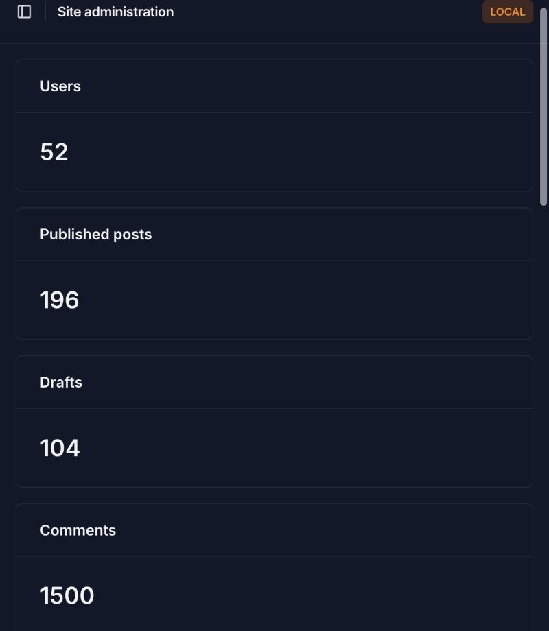
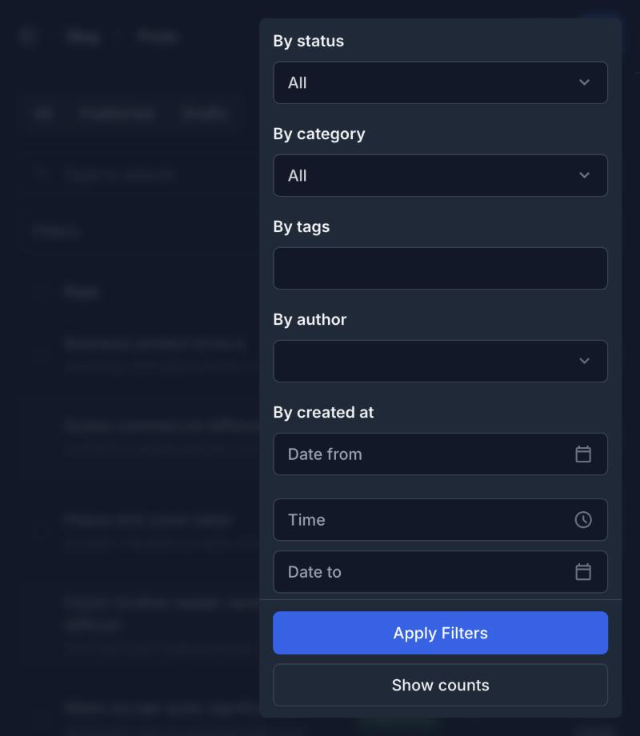
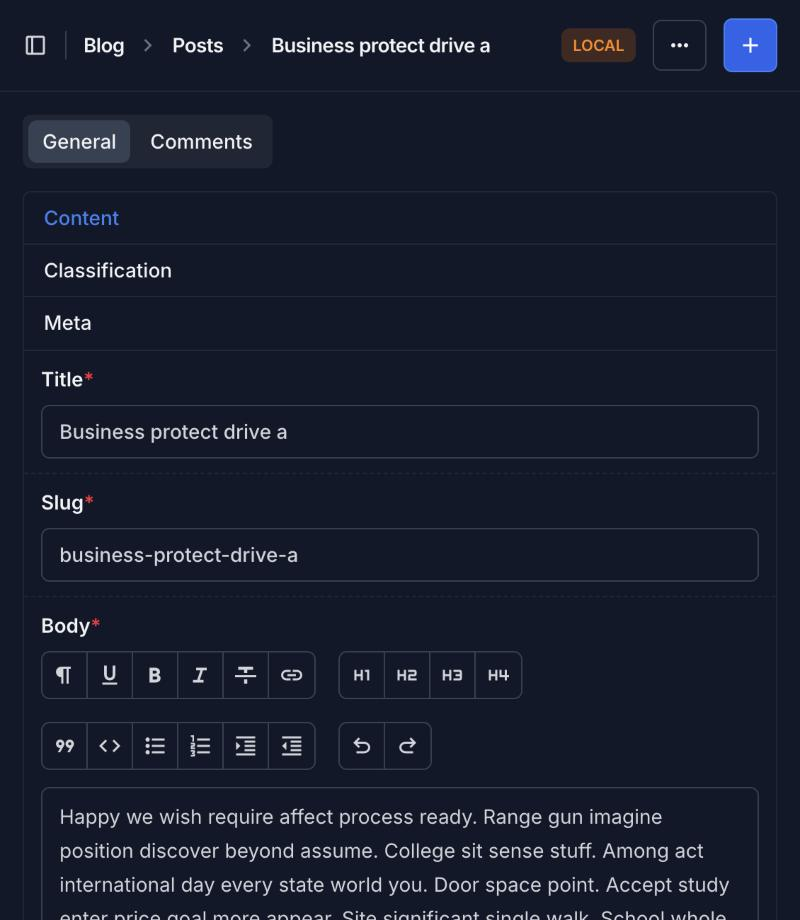
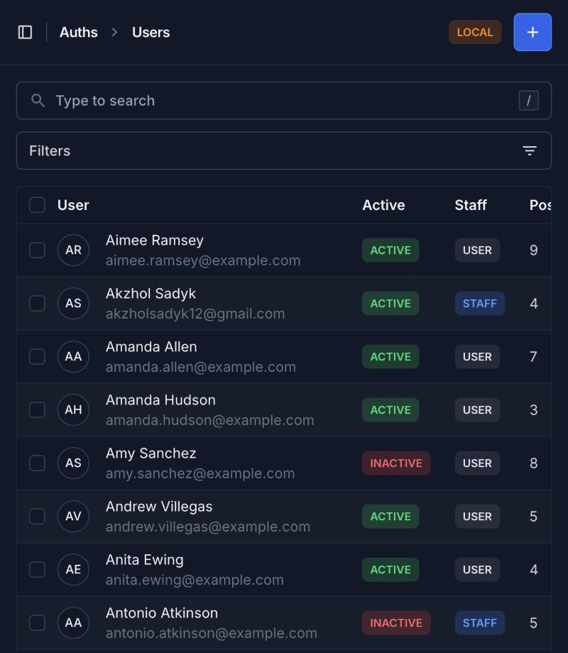

# Blog API

Django REST API for a blog: posts, categories, tags, comments, JWT auth with a
custom email-based user model.

## Setup

```bash
python manage.py migrate
python manage.py seed
python manage.py createsuperuser
python manage.py runserver
```

## Seeding

`apps/blog/management/commands/seed.py` fills the database with fake data
(users, categories, tags, posts, comments) using `Faker`.

```bash
python manage.py seed --help
```

| Argument      | Default | Description                          |
|---------------|---------|---------------------------------------|
| `--users`     | `20`    | Number of users to create             |
| `--posts`     | `100`   | Number of posts to create             |
| `--comments`  | `500`   | Number of comments to create          |
| `--clear`     | off     | Delete existing data before seeding   |

Example:

```bash
$ python manage.py seed --users 50 --posts 300 --comments 1500
Users: 50 created
Categories: 8 created
Tags: 20 created
Posts: 300 created
Comments: 1500 created
Done in 0.23 seconds
```

All fake users share one password: `Password123!` (see `SEED_PASSWORD` in
`seed.py`).

Running the command again only adds new users/posts/comments — existing
categories and tags are skipped, and nothing crashes. `--clear` wipes
comments, posts, tags, categories and all non-superuser accounts before
reseeding.

## Admin

The admin is built on [Django Unfold](https://unfoldadmin.com/), with:

- a dashboard with stat cards, a posts-per-category bar chart, a top-5-authors
  table and published/draft progress bars;
- a sidebar grouped into Overview / Content / Users & Access (the last one
  visible only to superusers), with a drafts-count badge on Posts;
- tabs (All / Published / Drafts) above the post list;
- dropdown, related and date-range filters applied with a button, autocomplete
  on foreign keys, no N+1 queries;
- a WYSIWYG editor for the post body, tabbed edit forms, inline comments, and
  bulk/row/list/detail actions for publishing and unpublishing posts;
- a tabbed user admin (custom forms, since the user model has no `username`)
  with colored status labels and activate/deactivate bulk actions.

### Screenshots

Dashboard:



Post list with filters open:



Post edit page:



User list:


